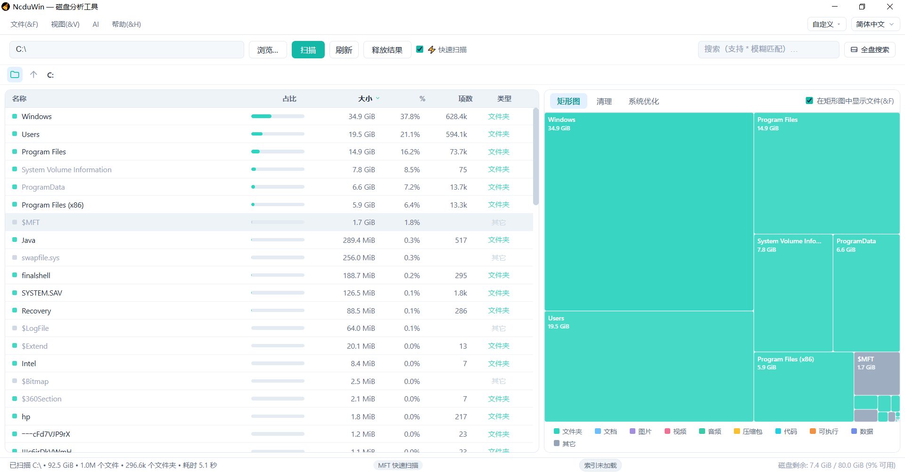
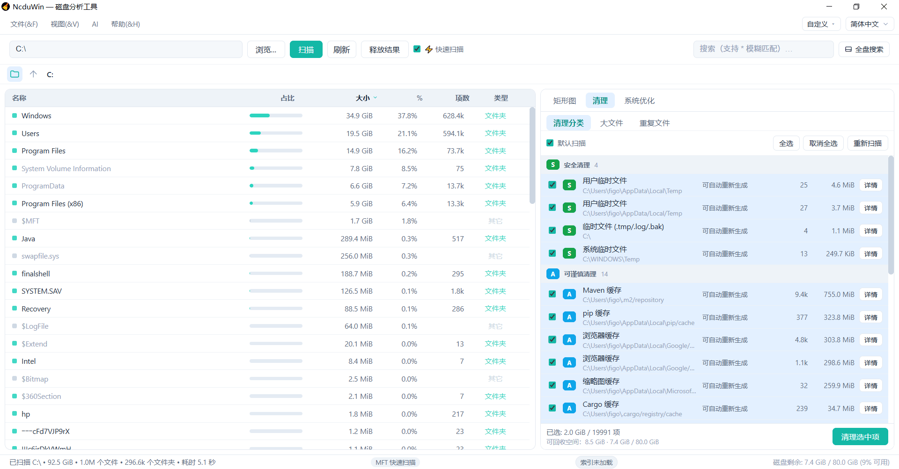
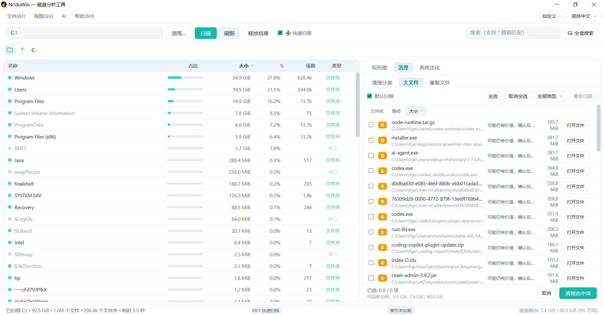
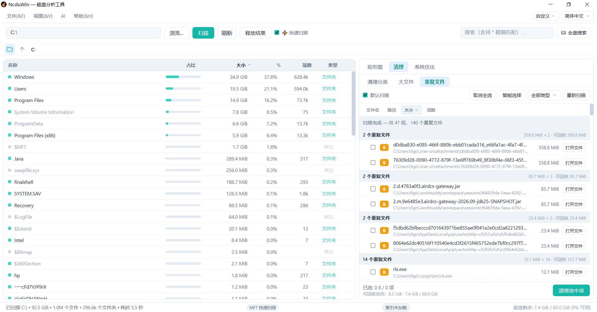
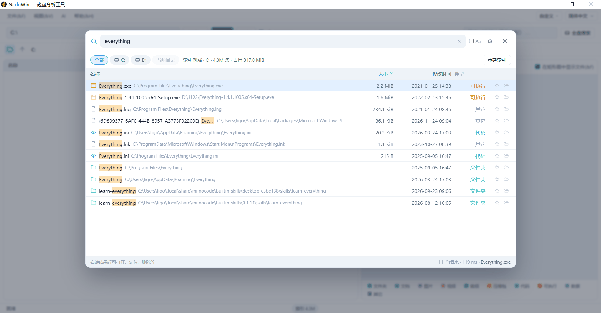
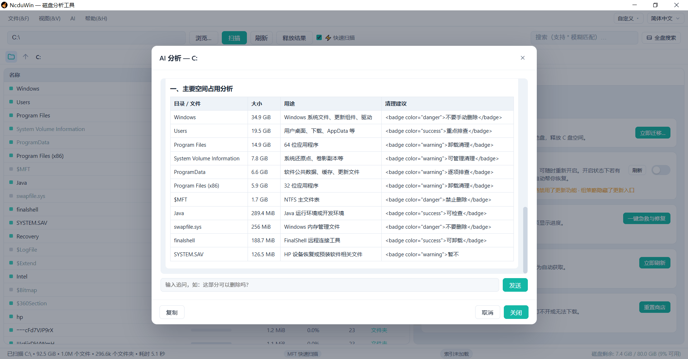
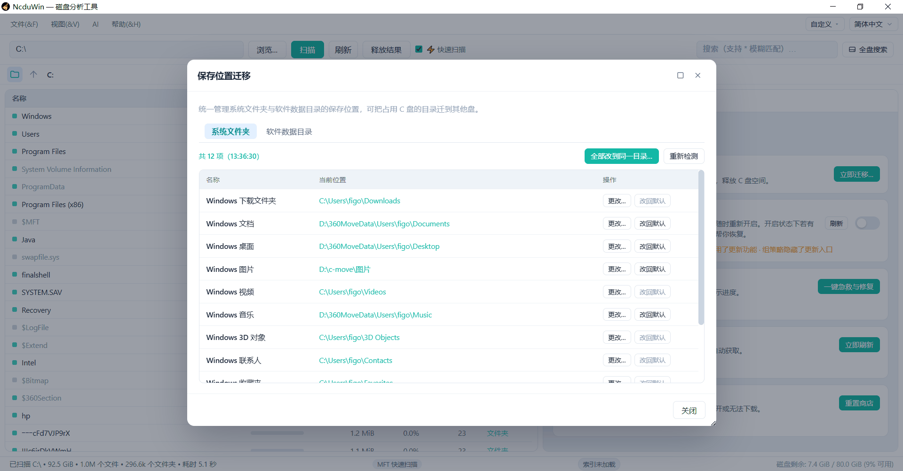
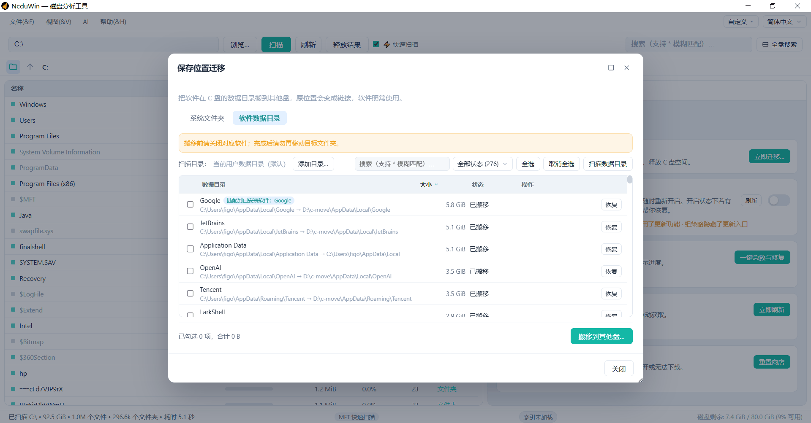

# NcduWin

[](LICENSE)
[](https://www.rust-lang.org)
[](https://tauri.app)
[](https://react.dev)
[](#运行环境)
[](#)

**[English](README_EN.md)** | **[中文](README.md)**

> **分支说明**
>
> - `master`（默认分支）：**最新版本**，由 C++/Qt 全面重构为 **Rust + Tauri 2**，当前版本 2.0.2，推荐下载使用本分支。
> - [`qt`](../../tree/qt)：旧版本，**C++17 + Qt 6** 实现，版本 1.1.0，仅作历史存档，不再新增功能。

> 一款现代、浅色主题的 Windows 磁盘使用分析器，灵感来自 Linux 的 [`ncdu`](https://dev.yorhel.nl/ncdu)。

NcduWin 是一个原生 Windows 桌面应用：Rust 负责扫描、清理、迁移等系统级操作，Tauri 2 承载界面，前端使用 React 19 + TypeScript + Vite 构建。它以安装包或便携包分发，开箱即支持简体中文与英语。

---

## ✨ 功能特性

- **极速扫描** — 直接读取 NTFS 主文件表（MFT）枚举文件，并保留传统目录遍历作为回退通道；多线程并行处理，大容量磁盘也能快速完成，扫描过程可随时取消。硬链接的多条路径与文件型重解析点（云占位、AppX 存根等）均完整计入，目录大小与资源管理器一致。
- **内存保护** — 扫描时监控可用内存，内存不足会提前停止并明确提示结果可能不完整，避免拖垮系统。
- **跳过重型目录** — 自动跳过 `WinSxS`、`node_modules` 等巨型目录的深度扫描，目录大小仍然展示。
- **双重视图** — 左侧 ncdu 风格文件列表，右侧交互式矩形树图，配合文件类型图例、面包屑与搜索框，快速定位空间占用；底部状态栏实时显示扫描耗时、处理速度与文件/目录计数。
- **全局搜索** — 基于 NTFS MFT 与 USN 变更日志的 Everything 风格全盘搜索，按下 `Ctrl+Shift+F` 随时唤起；支持 `ext:` `size:` `path:` `dm:` 过滤、`*` 通配符以及 `|` 或、`!` 非语法，并提供搜索历史与书签。
- **一键清理** — 「清理」标签页一次性扫描三类内容（Windows、Program Files、ProgramData 等系统与程序目录不纳入，避免误删）：
  - 常见垃圾：临时文件、浏览器缓存、pip/npm 等构建缓存
  - 大文件：≥50MB 的可疑大文件（归档包 ≥100MB 单独标记）
  - 重复文件：≥1MB 的文件按「大小分组 → 前 4KB 哈希 → 全文件哈希」三级漏斗查找
- **五级安全等级** — S/A/B/C/D 分级标注，系统状态与用户个人数据永不被自动勾选。
- **清理方式可控** — 「默认扫描」勾选决定顶部扫描是否包含该类；未勾选的可随时「重新扫描」；支持全选、取消全选与智能选择。
- **安全删除** — 删除前必须二次确认，可选「移入回收站」或「永久删除」；仅在权限不足时提示以管理员身份重试。
- **AI 智能分析** — 选中文件、目录或清理项交给 AI 说明用途与清理风险，也可打开「AI 问答」连续追问；兼容 OpenAI 风格接口，Base URL、模型与密钥在「AI → AI 设置」中配置。
- **AI 密钥安全存储** — API Key 保存在 Windows 凭据管理器（服务名 `NcduWin`），不以明文落盘。
- **主题与语言** — 支持跟随系统 / 浅色 / 深色主题，并可自定义配色；中英双语随时切换，窗口标题同步变化。
- **系统配置优化** — 独立「系统优化」标签页：
  - Windows 自动更新：一键开关；开启状态下若被其他软件关闭，会自动检测并修复服务、策略、计划任务、BITS、hosts、WSUS 等被改动的位置
  - 断网急救箱：重置 IP / DNS / IPv6 / Winsock / 防火墙并续约 DHCP，全过程显示进度
  - 刷新 DNS 缓存、重置应用商店缓存
  - 所有命令均在后台静默执行，不弹终端窗口
- **保存位置迁移** — 把占用 C 盘的目录整体搬到其他磁盘，原位置保留目录联接（junction），软件无需重新配置：
  - 系统文件夹：下载 / 文档 / 桌面 / 图片 / 视频 / 音乐 / 3D 对象 / 联系人 / 收藏夹 / 链接 / 保存的游戏 / 搜索，共 12 个 Windows 库文件夹
  - 软件数据目录：扫描 AppData / LocalAppData / LocalLow 及文档下的用户数据，支持批量勾选迁移
- **迁移安全机制** — 复制 → 校验（大小与文件数）→ 建立目录联接 → 删除旧目录的分步流程，配合迁移日志实现中断续做与一键还原；目标目录写入「请勿删除、移动或重命名」标记。
- **占用程序处理** — 搬移前检查目录占用并列出「程序 + PID」，可关闭的先请求退出、超时再强制结束；系统关键进程绝不自动关闭；失败时说明是谁占用、该怎么处理。
- **残留清理与状态筛选** — 搬回时删不掉的副本会记录并出现「清理残留」入口；「状态」列支持多选筛选，已勾选状态与统计只针对可见行。
- **改回默认位置** — 每个系统文件夹都有「改回默认」按钮，已处于默认位置时自动禁用，可把文件一并搬回。
- **自动更新提示** — 启动后后台静默检查新版本，有更新时在右下角弹出提示；安装版可下载并安装，便携版仅提示下载地址。
- **便携版与安装版** — NSIS 安装包默认安装到当前用户，安装时静默移除旧版 Qt 应用；便携版解压即用，不写入卸载信息。
- **稳定性** — 完整操作日志、全局异常兜底与崩溃错误页，异常情况记录日志而不是直接退出。

---

## 📸 截图

| 文件列表 + 树图 | 清理面板 |
|---|---|
|  |  |

| 大文件 | 重复文件 |
|---|---|
|  |  |

| 全盘搜索 | AI 分析 |
|---|---|
|  |  |

| 系统优化 | 系统文件夹位置迁移 |
|---|---|
|  |  |

| 用户数据目录位置迁移 | |
|---|---|
|  | |

---

## 🚀 快速开始

### 选项 A — 下载发布版本

1. 前往 [Releases](../../releases) 页面。
2. 下载安装包 `NcduWin_2.0.2_x64-setup.exe`，或便携包 `NcduWin_2.0.2_x64-portable.zip`。
3. 安装包按提示完成安装；便携包解压到任意目录后直接运行 `NcduWin.exe`，无需安装。

### 运行环境

- Windows 10（1803 及以上）或 Windows 11，64 位。
- Microsoft Edge WebView2 运行时（Windows 11 与新版 Windows 10 已自带，缺失时可用安装包的在线引导安装）。

### 选项 B — 从源码构建

**环境要求：**

- Windows 10/11 64 位
- [Node.js](https://nodejs.org/) 20.19+ 或 22.12+（Vite 7 要求）
- [Rust](https://www.rust-lang.org/tools/install) stable，MSVC 工具链（最低 1.77.2）
- [Visual Studio 2022](https://visualstudio.microsoft.com/) 或 Build Tools，勾选「使用 C++ 的桌面开发」与 Windows SDK

```bash
git clone https://github.com/xiaodingfeng/ncdu-win-qt.git
cd ncdu-win-qt
npm install
npm run tauri dev      # 开发模式（前端热更新 + Rust 后端）
npm run tauri build    # 生成安装包与可执行文件
```

也可以直接双击根目录的 `package.bat` 一键打包（自动安装依赖、构建前端、编译 Rust、生成安装包与便携包），产物位于：

- 安装包：`src-tauri/target/release/bundle/nsis/NcduWin_2.0.2_x64-setup.exe`
- 便携包：`src-tauri/target/release/bundle/portable/NcduWin_2.0.2_x64-portable.zip`

### 版本与发布配置

`src-tauri/app-config.json` 是唯一的发布配置入口，包含版本号、产品名、主页、下载地址模板、更新检查地址与 AI 接口地址。执行 `package.bat` 时会自动把版本号同步到 `src-tauri/tauri.conf.json`、`package.json` 与 `src-tauri/Cargo.toml`，保证全链路版本一致。

---

## 📁 项目结构

```
ncdu-win-qt/
├── index.html              # 前端入口页面
├── package.json            # 前端依赖与 npm 脚本
├── tsconfig.json
├── vite.config.ts
├── package.bat             # 一键打包入口（双击运行）
├── scripts/
│   ├── build-release.ps1   # 构建 + 安装包 + 便携包
│   └── 使用说明.txt         # 便携包内附说明（打包时自动同步版本号）
├── src/                    # React 前端
│   ├── App.tsx / main.tsx
│   ├── styles.css
│   ├── theme.ts            # 主题调色板
│   ├── components/         # 界面组件：扫描页 / 清理 / 树图 / 全局搜索 / 迁移 / 各类弹框
│   │   └── ui/             # 自定义下拉、多选、颜色选择与锚定弹层
│   ├── context/            # 设置、语言、应用配置上下文
│   ├── i18n/               # 文案外壳（shell.ts）与 locales/zh.json、en.json
│   ├── lib/                # 后端命令封装（扫描 / 清理 / 迁移 / AI / 系统优化 / 日志 / Markdown）
│   └── types/
├── src-tauri/              # Rust 后端
│   ├── src/
│   │   ├── main.rs / lib.rs
│   │   ├── scan.rs / mft.rs        # 扫描、NTFS MFT/USN 直读（含全局搜索）
│   │   ├── cleanup.rs              # 清理分类、大文件、重复文件
│   │   ├── appsync.rs / appmove.rs # 保存位置迁移与搬移
│   │   ├── sysopt.rs               # 系统配置优化
│   │   ├── ai.rs                   # AI 请求与流式响应
│   │   ├── ops.rs / locker.rs / elevate.rs
│   │   └── settings.rs / config.rs / legacy.rs / misc.rs
│   ├── tauri.conf.json
│   ├── app-config.json             # 发布配置（版本 / 下载 / 更新 / AI 地址）
│   ├── capabilities/               # Tauri 权限配置
│   ├── icons/                      # 应用图标
│   └── resources/                  # 迁移目标「请勿删除」标记图标
├── docs/                   # 官网与截图
├── app.ico                 # 图标源文件
├── LICENSE
├── README.md
└── README_EN.md
```

---

## ⌨️ 键盘快捷键

| 快捷键 | 操作 |
|---|---|
| `Ctrl+O` | 打开文件夹… |
| `F5` | 重新扫描当前目录 |
| `Backspace` | 返回上级目录 |
| `Enter` | 打开选中的文件夹 |
| `Delete` | 将选中项移至回收站 |
| `Shift+Delete` | 永久删除选中项 |
| `Ctrl+F` | 聚焦搜索框 |
| `Ctrl+Shift+F` | 打开全盘搜索 |
| `Esc` | 清除搜索 / 清除选择 |

---

## 🔐 数据与隐私

| 内容 | 位置 |
|---|---|
| 设置文件 | `%APPDATA%\cn.fengzhengx.ncduwin\settings.json` |
| 日志文件 | `%LOCALAPPDATA%\cn.fengzhengx.ncduwin\logs\ncduwin.log`（单文件 2MB，保留最近 5 个） |
| 迁移日志 | `%APPDATA%\cn.fengzhengx.ncduwin\move-journal.json` |
| AI API Key | Windows 凭据管理器，服务名 `NcduWin` |

删除上述目录即可完全清除本软件产生的本地数据。

---

## 🧪 开发

### 常用命令

```bash
npm run dev          # 仅启动前端（Vite，端口 1420）
npm run tauri dev    # 启动完整应用（含 Rust 后端）
npm run build        # 前端类型检查 + 构建到 dist/
npm run tauri build  # 构建安装包
```

### 添加翻译

1. 复制 `src/i18n/locales/zh.json` 为 `src/i18n/locales/<code>.json` 并翻译全部值。
2. 在 `src/context/I18nContext.tsx` 中引入该语言包。
3. 在 `src/types/settings.ts` 的语言类型与 `src/components/MenuBar.tsx` 的语言选项中补充该语言。

---

## 📝 许可证

MIT © NcduWin Contributors。详见 [LICENSE](LICENSE)。

本项目灵感来自 Yoran Heling 的 [`ncdu`](https://dev.yorhel.nl/ncdu)，并使用 Bruls、Houtman 和 van Wijk（2000）的矩形树图算法。所有商标归各自所有者所有。
