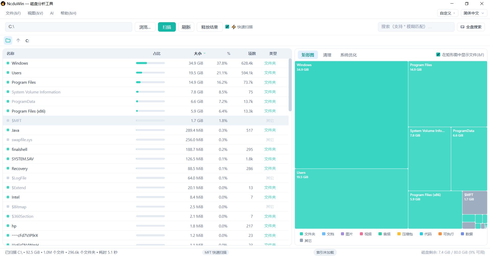
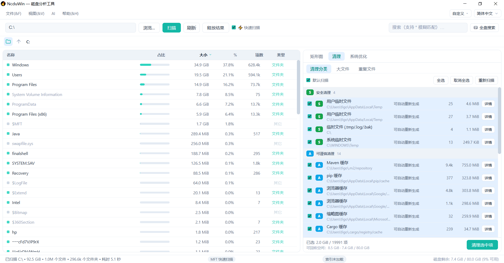
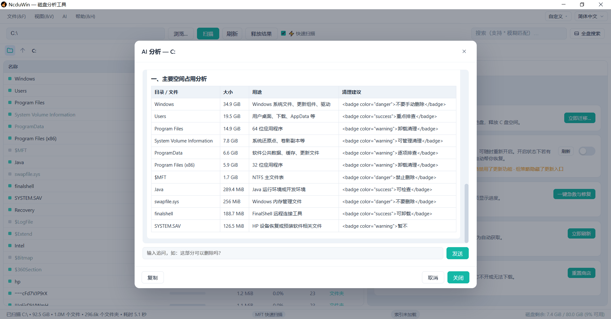
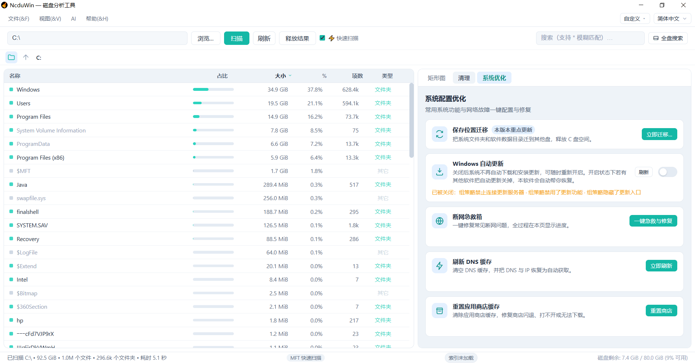
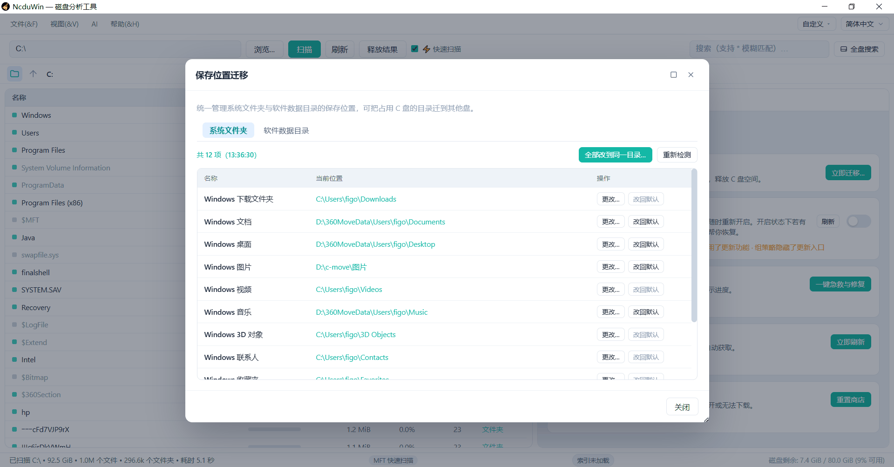
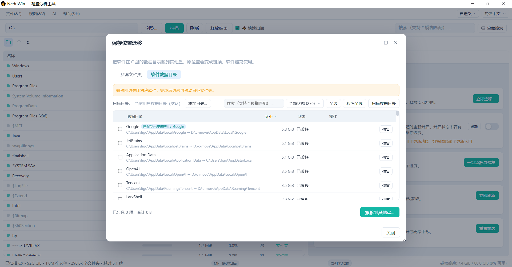

# NcduWin

[](LICENSE)
[](https://www.rust-lang.org)
[](https://tauri.app)
[](https://react.dev)
[](#requirements)
[](#)

**[English](README_EN.md)** | **[中文](README.md)**

> **Branch notice**
>
> - `master` (default branch): the **latest release**, fully rebuilt from C++/Qt into **Rust + Tauri 2**, currently 2.0.0 — this is the branch to download and use.
> - [`qt`](../../tree/qt): the legacy **C++17 + Qt 6** implementation, version 1.1.0, kept for archival only and no longer developed.

> A modern, light-themed disk usage analyzer for Windows, inspired by Linux [`ncdu`](https://dev.yorhel.nl/ncdu).

NcduWin is a native Windows desktop application: Rust handles scanning, cleanup and system-level operations, Tauri 2 hosts the shell, and the UI is built with React 19 + TypeScript + Vite. It ships as an installer or a portable package and supports English / 简体中文 out of the box.

---

## ✨ Features

- **Blazing fast scanning** — enumerates files by reading the NTFS Master File Table (MFT) directly, with the classic directory walk kept as a fallback path. Multi-threaded processing keeps large drives responsive, and a scan can be cancelled at any time.
- **Memory guard** — available memory is monitored during scanning; if it runs low the scan stops early with a clear notice that results may be incomplete instead of dragging the system down.
- **Skips heavy directories** — giant trees such as `WinSxS` and `node_modules` are not walked deeply, while their sizes are still shown.
- **Dual visualization** — an ncdu-style file list on the left and an interactive treemap on the right, plus a file-type legend, breadcrumbs and a search box.
- **One-click cleanup** — the Cleanup tab scans three kinds of content in one go:
  - Common junk: temp files, browser caches, pip/npm build caches
  - Large files: suspicious files ≥50MB (archives ≥100MB are flagged separately)
  - Duplicates: files ≥1MB found by a three-stage funnel (size grouping → first-4KB hash → full-content hash)
- **Five safety levels** — S/A/B/C/D classification; system state and personal user data are never auto-selected.
- **Controlled cleanup** — a "Default scan" checkbox per group decides whether the top Scan button includes it; skipped groups can still be scanned on demand. Select all, deselect all and smart select are provided.
- **Safe deletion** — a second confirmation is always required, with "Move to Recycle Bin" or "Delete permanently"; elevation is only offered when failures are permission-related.
- **AI analysis** — hand a file, folder or cleanup item to the AI to explain what it is and how risky it is to remove, or keep asking follow-up questions in "AI Q&A". Works with any OpenAI-style endpoint; Base URL, model and key are configured under **AI → AI settings**.
- **AI keys kept safe** — the API key is stored in Windows Credential Manager (service name `NcduWin`), never as plain text on disk.
- **Theme and language** — follow the system theme, or pick light, dark or a custom palette; switch between Chinese and English at any time, with the window title following the language.
- **System optimization** — a dedicated System Optimization tab:
  - Windows Update: one toggle to turn automatic updates on or off; when enabled, tampering by other software is detected and repaired across services, policies, scheduled tasks, BITS, hosts and WSUS
  - Network first aid: resets IP / DNS / IPv6 / Winsock / firewall and renews DHCP, with live progress
  - Flush the DNS cache and reset the Microsoft Store cache
  - Every command runs silently in the background — no console windows
- **Relocate save locations** — move C-drive-hungry folders to another disk while a directory junction stays behind, so software keeps working with no reconfiguration:
  - System folders: Downloads / Documents / Desktop / Pictures / Videos / Music / 3D Objects / Contacts / Favorites / Links / Saved Games / Searches — all 12 Windows library folders
  - App data folders: scans AppData / LocalAppData / LocalLow and Documents for user data, with checkbox batch selection
- **Move safety net** — a stepwise copy → verify (size and file count) → create junction → remove source flow, backed by a move journal for resume-after-interruption and one-click restore; the target folder gets a "do not delete, move or rename" marker.
- **Programs holding the folder** — before a move, holders are listed as "program + PID"; closable programs are asked to exit first and forced only on timeout, while critical system processes are never closed automatically. Failures name the holder and say what to do next.
- **Leftovers and status filter** — a restore that cannot delete its copy records it and offers a "remove leftover" action; the Status column supports multi-select filtering, and ticks plus totals only apply to visible rows.
- **Back to default** — every system folder has a "restore default" button, disabled when already at the default, and can move the files back.
- **Update prompt** — a background check runs after startup and shows a bottom-right prompt when a new version exists; the installed build can download and install it, the portable build only shows the download link.
- **Installer and portable builds** — the NSIS installer installs per user and silently removes the legacy Qt app during setup; the portable zip runs without installation and writes no uninstall entry.
- **Stability** — full operation logs, global error boundaries and a crash error page: failures are logged instead of taking the app down.

---

## 📸 Screenshots

| File list + treemap | Cleanup panel |
|---|---|
|  |  |

| AI analysis | System optimization |
|---|---|
|  |  |

| System folder relocation | User data folder relocation |
|---|---|
|  |  |

---

## 🚀 Quick start

### Option A — Download the release

1. Go to the [Releases](../../releases) page.
2. Download `NcduWin_2.0.0_x64-setup.exe` or the portable `NcduWin_2.0.0_x64-portable.zip`.
3. Run the installer and follow the prompts, or unzip the portable package and run `NcduWin.exe` — no installation required.

### Requirements

- Windows 10 (1803 or later) or Windows 11, 64-bit.
- Microsoft Edge WebView2 Runtime (included in Windows 11 and recent Windows 10; the installer can bootstrap it when missing).

### Option B — Build from source

**Requirements:**

- Windows 10/11 64-bit
- [Node.js](https://nodejs.org/) 20.19+ or 22.12+ (required by Vite 7)
- [Rust](https://www.rust-lang.org/tools/install) stable with the MSVC toolchain (minimum 1.77.2)
- [Visual Studio 2022](https://visualstudio.microsoft.com/) or Build Tools with "Desktop development with C++" and the Windows SDK

```bash
git clone https://github.com/xiaodingfeng/ncdu-win-qt.git
cd ncdu-win-qt
npm install
npm run tauri dev      # dev mode (frontend HMR + Rust backend)
npm run tauri build    # build installer and executable
```

You can also double-click `package.bat` in the repository root to package everything in one step (installs dependencies, builds the frontend, compiles Rust, produces the installer and the portable zip). Outputs:

- Installer: `src-tauri/target/release/bundle/nsis/NcduWin_2.0.0_x64-setup.exe`
- Portable: `src-tauri/target/release/bundle/portable/NcduWin_2.0.0_x64-portable.zip`

### Version and release configuration

`src-tauri/app-config.json` is the single entry point for release settings: version, product name, homepage, download URL template, update check URL and AI endpoints. Running `package.bat` syncs the version into `src-tauri/tauri.conf.json`, `package.json` and `src-tauri/Cargo.toml`, keeping the whole chain consistent.

---

## 📁 Project layout

```
ncdu-win-qt/
├── index.html              # Frontend entry page
├── package.json            # Frontend dependencies and npm scripts
├── tsconfig.json
├── vite.config.ts
├── package.bat             # One-click packaging entry (double-click)
├── scripts/
│   ├── build-release.ps1   # Build + installer + portable package
│   └── 使用说明.txt         # Portable readme (version synced while packaging)
├── src/                    # React frontend
│   ├── App.tsx
│   ├── main.tsx
│   ├── styles.css
│   ├── theme.ts            # Theme palettes
│   ├── components/         # UI components (scan page / cleanup / treemap / dialogs)
│   ├── context/            # Settings, i18n and app-config contexts
│   ├── i18n/locales/       # zh.json / en.json
│   ├── lib/                # Backend command wrappers (scan / cleanup / move / AI / system)
│   └── types/
├── src-tauri/              # Rust backend
│   ├── src/
│   │   ├── main.rs / lib.rs
│   │   ├── scan.rs / mft.rs        # Scanning and NTFS MFT reader
│   │   ├── cleanup.rs              # Categories, large files, duplicates
│   │   ├── appsync.rs / appmove.rs # Save-location sync and moving
│   │   ├── sysopt.rs               # System optimization
│   │   ├── ai.rs                   # AI requests and streaming
│   │   ├── ops.rs / locker.rs / elevate.rs
│   │   └── settings.rs / config.rs / legacy.rs / misc.rs
│   ├── tauri.conf.json
│   ├── app-config.json             # Release config (version / download / update / AI)
│   ├── installer-hooks.nsh         # NSIS pre-install hook (removes the legacy Qt app)
│   ├── capabilities/               # Tauri permissions
│   ├── icons/                      # Application icons
│   └── resources/                  # "Do not delete" marker for move targets
├── docs/                   # Website and screenshots
├── app.ico                 # Icon source
├── LICENSE
├── README.md
└── README_EN.md
```

---

## ⌨️ Keyboard shortcuts

| Shortcut | Action |
|---|---|
| `Ctrl+O` | Open folder… |
| `F5` | Re-scan the current folder |
| `Backspace` | Go to the parent folder |
| `Enter` | Open the selected folder |
| `Delete` | Move selection to Recycle Bin |
| `Shift+Delete` | Delete selection permanently |
| `Ctrl+F` | Focus the search box |
| `Esc` | Clear search / clear selection |

---

## 🔐 Data and privacy

| Item | Location |
|---|---|
| Settings | `%APPDATA%\cn.fengzhengx.ncduwin\settings.json` |
| Log file | `%LOCALAPPDATA%\cn.fengzhengx.ncduwin\logs\ncduwin.log` (2MB per file, 5 most recent kept) |
| Move journal | `%APPDATA%\cn.fengzhengx.ncduwin\move-journal.json` |
| AI API key | Windows Credential Manager, service name `NcduWin` |

Deleting these locations removes all local data produced by this app.

---

## 🧪 Development

### Common commands

```bash
npm run dev          # Frontend only (Vite, port 1420)
npm run tauri dev    # Full app (with the Rust backend)
npm run build        # Type-check and build the frontend into dist/
npm run tauri build  # Build the installer
```

### Adding a translation

1. Copy `src/i18n/locales/en.json` to `src/i18n/locales/<code>.json` and translate every value.
2. Import the new locale in `src/context/I18nContext.tsx`.
3. Extend the language type in `src/types/settings.ts` and the language list in `src/components/MenuBar.tsx`.

---

## 📝 License

MIT © NcduWin Contributors. See [LICENSE](LICENSE).

This project is inspired by [`ncdu`](https://dev.yorhel.nl/ncdu) by Yoran Heling and uses the squarified treemap algorithm by Bruls, Houtman & van Wijk (2000). All trademarks belong to their respective owners.
